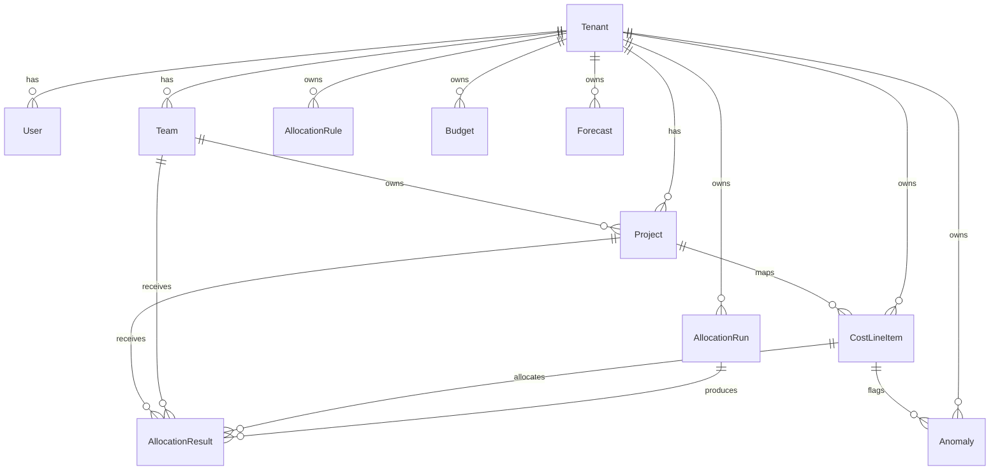

# Domain Model

## Entity Ownership Map

- `Tenant`
  - Schema/model: `prisma/schema.prisma` (`model Tenant`)
  - Primary service owner: `src/services/allocationRunService.ts` (`createRunAndQueue`, `processQueuedAllocationRun`)
- `User`
  - Schema/model: `prisma/schema.prisma` (`model User`)
  - Primary service owner: `src/lib/auth/session.ts` (`requireSession`)
- `Team`
  - Schema/model: `prisma/schema.prisma` (`model Team`)
  - Primary service owner: `src/services/allocationRuleService.ts` (rule targeting by `targetTeamId`)
- `Project`
  - Schema/model: `prisma/schema.prisma` (`model Project`)
  - Primary service owner: `src/services/allocationEngineService.ts` (fallback project allocation)
- `CostLineItem`
  - Schema/model: `prisma/schema.prisma` (`model CostLineItem`)
  - Primary service owner: `src/services/ingestionService.ts` (`ingestCostLineItems`)
- `AllocationRule`
  - Schema/model: `prisma/schema.prisma` (`model AllocationRule`)
  - Primary service owner: `src/services/allocationRuleService.ts` (`createRule`, `listRules`)
- `AllocationRun`
  - Schema/model: `prisma/schema.prisma` (`model AllocationRun`)
  - Primary service owner: `src/services/allocationRunService.ts` (`assertValidRunTransition`, `processQueuedAllocationRun`)
- `AllocationResult`
  - Schema/model: `prisma/schema.prisma` (`model AllocationResult`)
  - Primary service owner: `src/services/allocationEngineService.ts` (`computeAllocationResults`)
- `Budget`
  - Schema/model: `prisma/schema.prisma` (`model Budget`)
  - Primary service owner: `src/services/budgetService.ts` (`createBudgetEntry`, `getBudgetsForMonth`)
- `Anomaly`
  - Schema/model: `prisma/schema.prisma` (`model Anomaly`)
  - Primary service owner: `src/services/anomalyService.ts` (`detectAnomaliesForMonth`)
- `Forecast`
  - Schema/model: `prisma/schema.prisma` (`model Forecast`)
  - Primary service owner: `src/services/forecastService.ts` (`generateForecastForMonth`)
